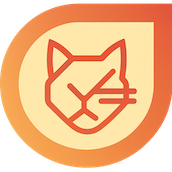

# Skrynja 🐱⛵

<p align="center">
  
</p>

**Skrynja** er en elegant AI-chatklient, målrettet **Sailfish OS**. Chat direkte med **Mistral AI** fra din Sailfish-enhed, med live **websøgning** via Mistrals Conversations API.

> 🦖 **Skrynja er udviklet med hjælp fra AI** — Mistral Vibe. Funktioner planlægges i [dokumenter/vejkort.md](dokumenter/vejkort.md), implementeres i samarbejde mellem en menneskelig udvikler og AI-agenter, valideres af CI og dækkes af unit tests før hver udgivelse.

## ✨ Funktioner

- 🌐 **Websøgning** — modellerne kan søge på nettet midt i en samtale, med kilder
- 🇫🇷 **Kun Mistral AI** — bygget på Conversations API (`/v1/conversations`)
- 🆓 **Gratis niveau understøttet** — Mistrals Experiment-abonnement virker med det samme
- 🔑 **Din egen nøgle** — API-nøglen gemmes tilsløret og sendes aldrig videre
- ⚡ **Streaming i realtid** — øjeblikkelige og glatte svar
- 🖼️ **Billeder (vision)** — vedhæft et foto, og lad Pixtral analysere det
- 🧠 **Live modelliste** — hentet fra Mistral, med en hurtigskifter ved inputfeltet
- 🎭 **Systemprompt & personaer** — forudindstillinger (Kortfattet, Oversætter, Kodeassistent) eller din egen instruktion
- 🎛️ **Genereringsindstillinger** — temperatur og svarslængde
- 💬 **Samtalehistorik** — søgning, detaljer pr. samtale, automatiske titler
- 📌 **Beskedhandlinger** — fastgør beskeder og kopier kodeblokke
- 📤 **Markdown-eksport** — til Dokumenter eller udklipsholderen
- 📊 **Statistik & badges** — aktivitetsdiagrammer, reel token-tælling (pr. dag/måned/samtale), sjove badges og top-AI-ord
- 🎨 **Native Sailfish-grænseflade** — swipe til historik, pulley-menu øverst, animationer, live cover med seneste svar
- 🌍 **Flersproget** — engelsk og dansk

## 🚀 Installation

### Forudsætninger

- Sailfish OS 3.0 eller nyere
- Internetforbindelse
- En Mistral AI API-nøgle (gratis niveau tilgængeligt)

### Byg fra kildekode

```bash
# Klon repoet
git clone https://github.com/storefyr/Skrynja.git
cd Skrynja

# Byg med Sailfish SDK
sfdk build

# Installér den genererede RPM
sfdk deploy --manual
```

### RPM-installation

Download `.rpm`-filen fra [udgivelserne](https://github.com/storefyr/Skrynja/releases) og installér den på din Sailfish-enhed.

## 🔧 Konfiguration

1. Start Skrynja
2. Åbn **Indstillinger** via pulley-menuen øverst
3. Indsæt din **Mistral API-nøgle**
4. Vælg din foretrukne model
5. Slå eventuelt **websøgning** til
6. Gem, og begynd at chatte!

## 📖 Brug

### Start en samtale

1. Åbn Skrynja
2. Skriv din besked i inputfeltet
3. Tryk på send-knappen eller Enter
4. Se svaret dukke op i realtid takket være streaming

### Websøgning

Slå **websøgning** til i Indstillinger (eller pr. samtale), så søger modellen på nettet, når den har brug for aktuel viden. Mens den søger, viser Skrynja en indikator for "Søger på nettet…", og svaret indeholder kilderne.

### Ny samtale

Swipe tilbage til samtalehistorikken og vælg **"Ny samtale"** i dens pulley-menu. Alternativt kan du starte en ny samtale fra coveret, når appen kører i baggrunden.

### Tilgængelige modeller

Modellisten hentes live fra Mistral og gemmes lokalt til offline brug. Modellen vælges, når en samtale oprettes; start en ny samtale for at skifte model.

## 🏗️ Teknisk arkitektur

### Qt C++-backend

- **MistralAPI** — HTTP-forespørgsler med SSE-streaming (Server-Sent Events) mod `/v1/conversations`
- **ConversationModel** — QAbstractListModel til beskedvisning
- **ConversationManager** — lokal samtalepersistens og sporing af fjern-samtale-id
- **SettingsManager** — indstillingspersistens med QSettings

### QML-frontend

- **ChatPage** — hovedgrænsefladen til samtaler med SilicaListView
- **SettingsPage** — API-konfiguration og modelvalg
- **ConversationHistoryPage** — gennemse tidligere samtaler
- **CoverPage** — aktivt cover med statistik

### Teknologier

- Qt 5.6 (QtCore, QtNetwork, QtQuick, QtQml)
- Sailfish Silica UI-komponenter
- Mistral Conversations API (REST + SSE-streaming)
- QML + JavaScript til grænsefladen

## 🎯 Mistral Conversations API

Skrynja kommunikerer udelukkende med Mistrals Conversations API — det er den, der gør websøgning mulig (`web_search`-værktøjet findes kun på denne API, ikke på Chat Completions).

### Endpoints

```
POST https://api.mistral.ai/v1/conversations#stream          (opret en samtale)
POST https://api.mistral.ai/v1/conversations/{id}#stream     (tilføj en besked)
POST https://api.mistral.ai/v1/conversations/{id}/restart#stream  (efter et annulleret svar)
GET  https://api.mistral.ai/v1/conversations/{id}/messages   (afstem før nyt forsøg)
DELETE https://api.mistral.ai/v1/conversations/{id}          (slet en samtale)
```

### Forespørgselsformat

```json
{
  "model": "mistral-small-latest",
  "instructions": "You are a helpful assistant.",
  "tools": [{"type": "web_search"}],
  "inputs": [{"object": "entry", "type": "message.input", "role": "user", "content": "Hello!"}],
  "completion_args": {"temperature": 0.7}
}
```

## 🔒 Sikkerhed & privatliv

- ✅ SailJail-sandboxing med minimale tilladelser (Internet, Billeder, Dokumenter)
- ✅ Ingen telemetri eller analyse
- ✅ Direkte kommunikation med Mistral (HTTPS), ingen mellemliggende server
- ✅ Lokal kopi af samtaler på din enhed
- ✅ **Stemmeinput anonymiseres på enheden før upload** (til som standard): toneskift + spektral hældning + telefonbånd-begrænsning + rystet støj, så din stemme er meget sværere at identificere ud fra optagelsen. Det er tilsløring, ikke kryptering — den transskriberede tekst kan stadig identificere dig, og din API-nøgle knytter forespørgslen til din konto. Lokal tale-til-tekst på enheden (whisper.cpp) blev testet og fravalgt: for langsom på en telefon-CPU og for dårlig til dansk.
- ⚠️ **Med Conversations API ligger samtalehistorikken også på Mistrals servere** — det er prisen for server-side hukommelse og websøgning
- ⚠️ På Mistrals gratis "Experiment"-abonnement indgår API-input og -output som standard i deres modeltræningsprogrammer. Fravælg det i Admin Consolens privatlivsindstillinger, hvis det betyder noget for dig
- ⚠️ Din API-nøgle giver adgang til din Mistral-konto — hold den hemmelig

## 🚀 Udgivelser & CI/CD

Skrynja bruger GitHub Actions til automatisk at bygge og udgive releases.

### Automatisk build

Hvert `vX.Y.Z`-tag udløser et build:

```bash
git tag v0.1.0
git push origin v0.1.0
```

Workflowet **build-docker.yml**:
- ✅ Bygger for aarch64 (Jolla Phone 2026, Jolla C2, Xperia 10 II/III/IV)
- ✅ Genererer changelog ud fra commits
- ✅ Opretter GitHub-release med RPM'en
- ✅ Udgiver automatisk

Kompilerede RPM'er findes under [Releases](https://github.com/storefyr/Skrynja/releases).

### PR-validering

Pull requests valideres automatisk af workflowet **pr-build.yml**, som bygger for aarch64 og kører unit test-suiten.

### Tests

Backend-klasserne er dækket af en QtTest-suite (`tests/`), der kører i CI ved hvert build og blokerer udgivelser ved fejl:

```bash
cd tests && qmake tests.pro && make && ./tst_skrynja
```

### Test en PR på enheden

Hvert PR-build pusher aarch64-RPM'en til en `pr-<N>-rpm` git-branch med et fast filnavn. Download scriptet direkte på din Jolla-telefon og kør det — ingen computer, ingen GitHub API, ingen autentifikation nødvendig:

```bash
# Én gang: download scriptet (fra PR-branchen)
curl -LO https://raw.githubusercontent.com/storefyr/Skrynja/feature/cancel-voice-recording/test-pr.sh

# Derefter for hver PR:
sh test-pr.sh 11        # downloader + installerer RPM'en for PR #11
```

Scriptet henter direkte fra `raw.githubusercontent.com` — det kalder ikke GitHub API'et (begrænset hastighed) og bruger ikke Actions artifacts (kræver autentifikation).

### For vedligeholdere

Se [RELEASE.md](RELEASE.md) for den komplette udgivelsesguide.

## 🤝 Bidrag

Bidrag er velkomne! Sådan deltager du:

1. Fork projektet
2. Opret en branch til din funktion (`git checkout -b feature/AmazingFeature`)
3. Commit dine ændringer (`git commit -m 'Add some AmazingFeature'`)
4. Push branchen (`git push origin feature/AmazingFeature`)
5. Åbn en Pull Request

## 🗺️ TODO / Roadmap

Se [dokumenter/vejkort.md](dokumenter/vejkort.md) for den fulde plan.

- [x] Websøgning via Conversations API
- [x] Omskrivning til Conversations API (opret/tilføj/genstart/afstem/slet)
- [x] Persistent lagring af samtaler
- [x] Eksport af samtaler (tekst, markdown)
- [x] Flere samtidige samtaler
- [x] Avancerede indstillinger (temperatur, max_tokens, systemprompt)
- [x] Oversættelser
- [x] Statistik, token-tælling, badges
- [ ] Rediger & generer svar via genstart på entryniveau
- [ ] Understøttelse af Mistral-agenter
- [ ] Brugerdefinerede farvetemaer

## 🐛 Kendte problemer

- Gratis niveau har strenge hastighedsbegrænsninger ved intensiv brug
- Streaming kan nogle gange være langsom afhængigt af netværksforbindelsen
- Ingen offline-understøttelse (kræver internetforbindelse)

## 📄 Licens

GNU General Public License v3.0 (GPL-3.0) — se [LICENSE](LICENSE) og [gnu.org/licenses/gpl-3.0](https://www.gnu.org/licenses/gpl-3.0.html) for detaljer.

## 🙏 Tak til

- **Mistral AI** for deres fremragende API, Conversations API og det generøse gratis niveau
- **Jolla** for Sailfish OS og Silica-frameworket
- **Sailfish-fællesskabet** for deres støtte og feedback

## 📧 Kontakt

[@storefyr](https://github.com/storefyr)

Projektlink: [https://github.com/storefyr/Skrynja](https://github.com/storefyr/Skrynja)

---

<p align="center">
  Lavet med ❤️ til Sailfish OS
</p>
